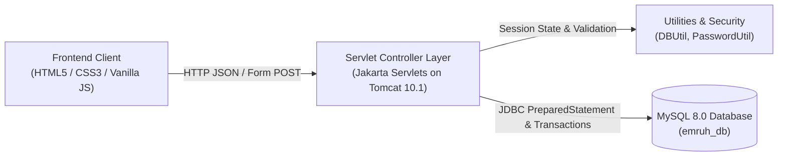

# e-mruh — College E-Commerce Platform

A full-stack college e-commerce web application developed in Java to help university students conveniently browse, order, and track college-compliant uniforms, laboratory coats, semester textbooks, and engineering stationery with direct campus hostel delivery.

---

## Features

- **Product Catalog & Details:** Dynamic catalog fetching live items from MySQL, with dedicated specification and stock availability views.
- **Search, Filter & Sort:** Instant cross-category product search, department filter pills (Uniforms, Lab Coats, Textbooks, Stationery), and price sorting (Low-to-High / High-to-Low).
- **Shopping Cart & Drawer:** Interactive cart drawer supporting quantity increments, item removals, dynamic subtotal calculations, and persistent state across page reloads.
- **Student Authentication & Session Management:** User registration and login backed by server-side `HttpSession` management and constant-time credential verification.
- **Secure Password Hashing:** Cryptographically strong password hashing using Java's native `PBKDF2WithHmacSHA256` with unique 128-bit salts and 310,000 iterations (OWASP recommendation). No plaintext passwords stored.
- **Transactional Checkout & Order Persistence:** Atomic order placement via JDBC transactions (`setAutoCommit(false)`), persisting orders and line items.
- **Inventory Stock Protection:** Row-level locking (`SELECT ... FOR UPDATE`) prevents race conditions or overselling. Atomically validates stock and decrements inventory on order success; safely rolls back on insufficient stock.
- **Order History ("My Orders"):** Authenticated students can track their previous purchases, order status, itemized costs, and campus delivery destinations.
- **Tamper-Resistant Pricing:** All order totals and unit prices are strictly verified against current MySQL database prices, ignoring any client-tampered prices.

---

## Technology Stack

- **Backend:** Java 21, Jakarta Servlet API (project deployment descriptor configured for version 5.0 schema; deployed on Apache Tomcat 10.1 which implements Jakarta Servlet 6.0), JDBC (Java Database Connectivity)
- **Database:** MySQL 8.0 (InnoDB engine, utf8mb4 charset)
- **Database Driver:** MySQL Connector/J 8.4.0 LTS
- **Application Server:** Apache Tomcat 10.1 (Jakarta EE 10 platform, implementing Jakarta Servlet 6.0, JSP 3.1, and EL 5.0)
- **Frontend:** Semantic HTML5, CSS3 (responsive design), Vanilla JavaScript (ES6+, Fetch API)
- **Development Tool:** Eclipse IDE for Enterprise Java and Web Developers

---

## Architecture & How It Works

The project follows a standard multi-tier dynamic web application architecture:



1. **Client Tier:** Vanilla JavaScript modules (`app.js`, `shop.js`, `auth.js`, `checkout.js`, `my-orders.js`) interact with the DOM and issue asynchronous `fetch()` requests with same-origin session credentials.
2. **Controller / API Layer:** Jakarta Servlets process incoming requests, validate inputs, enforce session authentication, and output standard JSON responses.
3. **Data Access Tier:** Plain JDBC utilizing `PreparedStatement` parameterized queries to prevent SQL injection, managing transactions atomically with explicit commit and rollback routines.
4. **Data Tier:** MySQL database (`emruh_db`) enforcing relational foreign key constraints, unique constraints, and check constraints across 4 InnoDB tables.

---

## Database Setup

The database schema and sample data are located in the `database/` folder.

### 1. Prerequisites
- MySQL Server 8.0+ running on port `3306`.
- MySQL Workbench or MySQL Command-Line Client.

### 2. Initialization Order
1. Open MySQL Workbench and connect to your local MySQL instance.
2. Open and execute `database/schema.sql`:
   - Creates the database `emruh_db` (if it does not exist).
   - Creates the required tables: `products`, `users`, `orders`, and `order_items`.
   > **Warning:** `database/schema.sql` contains `DROP TABLE IF EXISTS` statements. Do not rerun this script on an existing database if you wish to preserve saved orders or user accounts.
3. Open and execute `database/seed-products.sql`:
   - Safely seeds the catalog with 14 realistic college products across uniforms, lab coats, books, and stationery.
   - The script is idempotent (safe to rerun without creating duplicates).

For more detailed setup steps, refer to `database/README.md`.

---

## Configuration

Database credentials are decoupled from the source code and read from environment variables at runtime via `DBUtil.java`:

| Variable Name | Description | Default (if unset) |
|---|---|---|
| `EMRUH_DB_URL` | MySQL JDBC Connection URL | `jdbc:mysql://localhost:3306/emruh_db?useSSL=false&allowPublicKeyRetrieval=true&serverTimezone=UTC` |
| `EMRUH_DB_USER` | MySQL Username | `root` |
| `EMRUH_DB_PASSWORD` | MySQL User Password | *None (must be set)* |

### Setting Environment Variables in Eclipse:
1. In Eclipse, open the **Servers** tab.
2. Double-click **Tomcat v10.1 Server at localhost** -> click **Open launch configuration**.
3. Under the **Environment** tab, click **New...**:
   - Name: `EMRUH_DB_PASSWORD`
   - Value: `<your_local_mysql_password>`
4. Click **Apply** and **OK**.

> **Important:** Never hardcode your MySQL password in Java files or commit credentials to Git.

---

## Running the Project Locally

### Prerequisites
- **JDK 21** installed and configured in Eclipse.
- **Apache Tomcat 10.1.x** (which implements Jakarta Servlet 6.0 and runs Java 21).
- **MySQL Server 8.0.38+** running locally.

### Steps to Run:
1. **Import Project into Eclipse:**
   - Launch Eclipse -> **File** -> **Open Projects from File System...**
   - Choose `C:\Users\MANISHA\eclipse-workspace\e-mruh` and click **Finish**.
2. **Link Tomcat Server Runtime:**
   - Right-click the project -> **Properties** -> **Targeted Runtimes**.
   - Check **Apache Tomcat v10.1** -> click **Apply and Close**.
3. **Verify Dependencies:**
   - The MySQL driver `mysql-connector-j-8.4.0.jar` is located in `src/main/webapp/WEB-INF/lib/` and is automatically picked up by Eclipse under *Web App Libraries*.
4. **Deploy & Start Server:**
   - Right-click `e-mruh` in Project Explorer -> **Run As** -> **Run on Server**.
   - Select your Apache Tomcat 10.1 server and click **Finish**.
5. **Access Application:**
   - Open your browser and navigate to:
     ```
     http://localhost:8080/e-mruh/
     ```

---

## Project Structure

```text
e-mruh/
├── .gitignore                                # Git ignore rules for build files and secrets
├── .classpath                                # Eclipse Java build classpath
├── .project                                  # Eclipse project definition
├── database/
│   ├── README.md                             # Database execution guide & verification
│   ├── schema.sql                            # DDL schema for products, users, orders, order_items
│   └── seed-products.sql                     # Seed script for 14 college catalog items
├── src/main/java/
│   └── com/emruh/
│       ├── servlet/
│       │   ├── AuthStatusServlet.java        # GET /api/auth/me (session status)
│       │   ├── LoginServlet.java             # POST /api/auth/login
│       │   ├── LogoutServlet.java            # POST /api/auth/logout
│       │   ├── MyOrdersServlet.java          # GET /api/orders/my-orders
│       │   ├── OrderServlet.java             # POST /api/orders (transactional checkout)
│       │   ├── ProductServlet.java           # GET /api/products
│       │   ├── RegisterServlet.java          # POST /api/auth/register
│       │   └── TestDBServlet.java            # GET /test-db (DB connectivity test)
│       └── util/
│           ├── DBUtil.java                   # JDBC connection manager
│           └── PasswordUtil.java             # PBKDF2 password hashing & verification
└── src/main/webapp/
    ├── index.html                            # Campus store homepage
    ├── shop.html                             # Product catalog with search, filter, and sort
    ├── product-details.html                  # Product view with stock indicator
    ├── checkout.html                         # Checkout and delivery details form
    ├── login.html                            # Student sign-in page
    ├── register.html                         # Student account registration page
    ├── my-orders.html                        # Order history and delivery tracking
    ├── css/
    │   └── style.css                         # Application stylesheet
    ├── js/
    │   ├── app.js                            # Core app, cart drawer, auth profile menu
    │   ├── auth.js                           # Form validation and auth submission
    │   ├── checkout.js                       # Checkout handling and live order submission
    │   ├── mock-data.js                      # Reference mock data definitions
    │   ├── my-orders.js                      # Order history fetching and card rendering
    │   ├── product-details.js                # Product details fetching and cart integration
    │   └── shop.js                           # Shop search, filtering, and catalog rendering
    └── WEB-INF/
        ├── lib/
        │   └── mysql-connector-j-8.4.0.jar   # MySQL JDBC Driver
        └── web.xml                           # Jakarta Servlet deployment descriptor (version 5.0 schema)
```

---

## API Overview

All backend endpoints communicate via JSON and require UTF-8 encoding:

| Endpoint | HTTP Method | Auth Required | Description |
|---|---|---|---|
| `/test-db` | `GET` | No | Smoke test endpoint verifying MySQL database connectivity. |
| `/api/products` | `GET` | No | Returns the array of catalog products from `emruh_db.products`. |
| `/api/auth/register` | `POST` | No | Registers a new student account (`fullName`, `rollNumber`, `email`, `mobileNumber`, `password`, `confirmPassword`). Rejects unsupported methods. |
| `/api/auth/login` | `POST` | No | Authenticates user credentials and establishes an `HttpSession`. Rejects unsupported methods. |
| `/api/auth/logout` | `POST` | Yes | Terminates and invalidates the active server-side HTTP session. Rejects GET with HTTP 405. |
| `/api/auth/me` | `GET` | Yes | Returns current authenticated student details (`user_id`, `full_name`, `email`) or HTTP 401 if unauthenticated. |
| `/api/orders` | `POST` | Optional | Transactionally creates an order, validates stock, decrements inventory, and records order items. Supports guest or logged-in users. Rejects GET with HTTP 405. |
| `/api/orders/my-orders` | `GET` | Yes | Retrieves order history for the currently logged-in student session. |

---

## Security & Limitations

- **Password Security:** Passwords are never stored in plaintext. They are hashed using `PBKDF2WithHmacSHA256` with a random 16-byte salt and verified via constant-time comparison to prevent timing attacks.
- **Session Management:** Relies on standard server-managed `HttpSession` cookies (`JSESSIONID`). No auth tokens or credentials are saved in browser `localStorage` or `sessionStorage`.
- **SQL Injection Prevention:** All database operations utilize parameterized JDBC `PreparedStatement` queries.
- **Payment Model:** The application currently operates on a **Pay on Delivery** (Cash or UPI on campus arrival) model. Online payment gateway integration (e.g. Razorpay/Stripe) is not implemented.
- **Deployment Context:** Configured for local development on Apache Tomcat over standard HTTP. In a production environment, configuring explicit cookie flags (`Secure; HttpOnly; SameSite`), HTTPS termination (TLS/SSL), and a reverse proxy (such as Nginx) would be required.

---

## Future Enhancements

- **Payment Gateway Integration:** Adding Razorpay or Stripe for prepaid transactions.
- **Admin Management Portal:** Web-based portal for staff to update inventory stock, add new catalog products, and update delivery statuses.
- **Automated Testing Suite:** Unit and integration testing using JUnit 5 and Mockito.
- **Password Reset:** Secure email-based OTP or tokenized password recovery.
- **Containerization:** Docker container setup for automated Tomcat and MySQL orchestration.

---

## Author

- **GitHub Repository:** [https://github.com/ManishaVallapu/e-mruh](https://github.com/ManishaVallapu/e-mruh)
